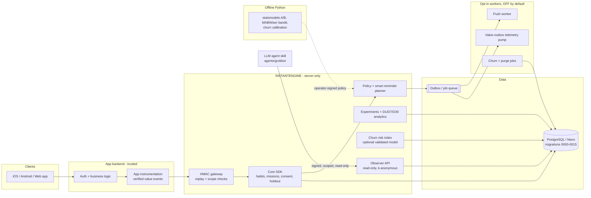

# INSTANTENGINE: consent-first retention engine for multi-app backends

INSTANTENGINE is a Node.js (ESM) and PostgreSQL retention engine. Several apps can share it from their own authenticated backends. It covers habits and streaks, contextual reminder planning, A/B experiment reporting, a transparent churn-risk index, and a **read-only, privacy-preserving tool surface for an LLM agent** that analyses retention data.

> **Status: source QA only. It is not deployed to production.** No real users, notifications, customer data or external AI models were connected in any of the test runs described here.

**v3.1.1 reliability patch (2026-10-22):** Daily churn scoring now defaults to the last completed UTC day and refuses explicit today/future dates. `pages` counts actual database page reads; `hasMore` is conservative if a full page hits `maxPages`. Ten regression tests cover UTC midnight, invalid days, pagination limits and production guards. See [`docs/V3_1_1_CHURN_FIXES.md`](docs/V3_1_1_CHURN_FIXES.md). Local source QA: 343 modern Node + 4 bridge + 137 legacy tests (484 total), plus 9 Python tests. No real retention uplift or push delivery is claimed.

## The problem it solves

Teams that run several consumer apps tend to re-implement the same retention mechanics in each app: streaks, reminders, experiments and churn signals. These copies often take shortcuts that hurt users and data quality:

- they send notifications without verified consent, during quiet hours, or after the user has stopped responding;
- they count app opens or clicks as "value" and report correlation as causal lift;
- they give analytics or AI agents raw, user-level data and write access.

INSTANTENGINE puts these rules in one tested, server-only engine. Any send decision has to pass deterministic safety policy (consent, holdout, quiet hours, cadence, fatigue caps) before a job is queued. Only backend-verified "value events" count toward progress. Experiment reports refuse to claim causality they can't support. The AI agent can only *observe* k-anonymised aggregates through signed, scoped, read-only calls.

## Architecture



Main modules:

| Area | Files |
|---|---|
| Core SDK and policy | `src/index.mjs`, `src/policy.mjs`, `src/habits.mjs`, `src/decisions.mjs`, `src/retention-next.mjs`, `src/smart-notifications.mjs` |
| Analytics and experiments | `src/analytics.mjs`, `src/duolingo-retention.mjs`, `src/integrations/posthog*.mjs`, `python/ab_statsmodels.py` |
| Churn | `src/churn-prediction.mjs`, `src/storage/churn-neon.mjs`, `python/churn_train_offline.py`, `bin/run-churn*.mjs` |
| Transport and security | `src/integrations/http-gateway.mjs` (HMAC, nonce replay protection, scope binding) |
| Storage | `src/storage/neon.mjs` (parameterised SQL), `src/storage/memory.mjs` (test adapter), `migrations/0000-0015` |
| Workers | `src/worker.mjs`, `src/integrations/value-outbox.mjs`, `src/integrations/graphile-worker.mjs`, `bin/` |
| AI agent surface | `src/integrations/grokbot-observer.mjs`, `src/storage/observer-neon.mjs`, `agents/grokbot/` (skill and signed CLI client) |
| Offline ML | `python/bandit_offline.py` (MABWiser), `src/integrations/bandit-policy.mjs` (operator-signed policy loader) |

### Where AI fits in, and where it doesn't

- **An LLM agent is an observer only.** It calls `agents/grokbot/observer-client.mjs`, which signs requests with HMAC credentials that the agent never sees. The server enforces scope, allowlists and k-anonymity no matter what the prompt says.
- **No generated notification text.** Reminders choose from templates the app has pre-approved. Model output can only pick among whitelisted templates or choose `no_send`.
- **Models are offline and fail closed.** Bandit policies must be signed by an operator before they load. A churn *probability* is only emitted when the model ships holdout and calibration evidence. Without that, the engine reports an uncalibrated risk *index* and labels it as one.

## Running locally

Requirements: Node.js >= 22 and Python 3 (CI uses 3.12; verified locally with 3.13) for the offline statistics tests. PostgreSQL is optional: the test suites use in-memory and injected SQL adapters and need no database or credentials.

```bash
git clone https://github.com/raphaelribeirob/INSTANTENGINE.git
cd INSTANTENGINE
npm ci                                   # no runtime dependencies; peers are optional

# keep the venv OUTSIDE the repo: check:manifest hashes every file in the tree
python3 -m venv ../instantengine-venv && . ../instantengine-venv/bin/activate   # provides `python` for test:stats
pip install -r python/requirements-retention.txt

npm test                 # Node unit/contract tests + example bridge + legacy SDK suite
npm run test:stats       # Python statistics / offline-model tests
npm run db:verify-install  # migration chain + bootstrap reproducibility (static check)
npm run check:manifest   # SHA-256 inventory of every shipped file
```

Optional: to apply the schema to a **local, disposable** PostgreSQL database (14+, with `pgcrypto` available), run the files in `migrations/` in order. Example with a database you created for this purpose:

```bash
for f in migrations/*.sql; do psql "$LOCAL_TEST_DATABASE_URL" -v ON_ERROR_STOP=1 -f "$f"; done
```

Never commit a real `DATABASE_URL`. `.env.example` lists every variable, and all features that can send or delete are OFF by default.

Demos (no network or credentials needed): `npm run demo:multiapp`, `npm run demo:smart-notifications`, `npm run demo:observer`, `npm run demo:churn`.

## Test results

These numbers come from a local run on 2026-10-22 (Node v24.22.0, Python 3.13.5) and match the commit that adds this README:

| Command | Result |
|---|---|
| `npm test`: `node --test test/*.test.mjs` (36 files) | **333 tests, 333 pass, 0 fail, 0 skipped, 0 todo** |
| `npm test`: example backend bridge test | **4 tests, 4 pass, 0 fail, 0 skipped** |
| `npm test`: legacy single-file SDK suite | **137 tests, 137 pass, 0 fail, 0 skipped** |
| `npm run test:stats` (Python `unittest`) | **Ran 9 tests, OK** (0 skipped) |
| `npm run db:verify-install` | **PASS**: bootstrap matches embedded SQL; 16 migration files in the expected order, with contract markers and no `DROP TABLE/SCHEMA/DATABASE` |
| `npm run check:manifest` | **PASS**: SHA-256 manifest matches all shipped files |

In total, `npm test` runs **474 Node tests** (all passing) and `test:stats` runs **9 Python tests**. One extra check was done by hand and is not part of CI: all 16 migrations were applied in a single transaction to a local PostgreSQL 17.11, creating 33 tables and 37 functions in a scratch schema. The transaction was then rolled back.

CI (`.github/workflows/instantengine-qa.yml`) runs the same commands on every push with Node 22 and Python 3.12.

## Limitations (honest list)

- **Not in production.** It hasn't run against live users, live Neon branches or real devices. `npm run db:verify-live` (a read-only Neon preflight) hasn't been run against a real database.
- **No proof of retention impact.** The suites check safety and correctness, not D1/D7/D30 uplift. No randomized experiment with real users has been run.
- **Push delivery hasn't been validated.** OneSignal/APNs/FCM delivery, callbacks and device behaviour haven't been tested end-to-end. Provider acceptance is not counted as delivery.
- **The churn model is uncalibrated by default.** The heuristic index is not a probability. No validated model has been trained on real outcome labels.
- **Much of the SQL is contract-tested, not executed.** Many storage tests check the SQL text and bound parameters through injected clients. Concurrency and RLS behaviour against a live PostgreSQL are untested.
- **The legacy code is dense.** `legacy/R3ENGINE_v1.1.mjs` is a large single-file SDK, kept so older integrations stay compatible. Historical names (`createTMNT`, `/tmnt/v1/action`, `r3_v1_*`, `river_v1_*`) remain on purpose to keep the signed wire protocol and schema stable.
- **Some docs are historical.** Several files in `docs/` are old acceptance and test reports, partly in Portuguese. Where they disagree with this README and the tests, the README and tests are correct.

## Security

The mapping uses the **OWASP Top 10:2025** and the **OWASP Top 10 for LLM Applications (2025)**. A control is listed only if an automated test exercises it. The test file and test name are given so you can check the claim. Anything else is marked **Not covered yet**.

### OWASP Top 10:2025

| Category | Control | Test (file › name) |
|---|---|---|
| A01 Broken Access Control | Scope is bound on the server; subject spoofing and unauthorised admin actions are rejected | `test/gateway.test.mjs` › "scope is server bound; subject spoof and unauthorized admin actions are rejected" |
| A01 | Tenant/app/environment isolation | `test/universal.test.mjs` › "stable holdout and isolation across tenants and environments"; `test/smart-notifications-v27.test.mjs` › "app/tenant isolation for decisions" |
| A01 | Workers only claim jobs from allowed environments and apps | `test/worker-security.test.mjs` › "neon claims only explicitly allowed environments before touching queue", "same-environment jobs from unconfigured apps are not claimed" |
| A02 Security Misconfiguration | Dangerous features are OFF by default; production needs a separate explicit flag | `test/worker.test.mjs` › "off by default, no provider configuration needed"; `test/posthog-ab.test.mjs` › "prod cannot be enabled without distinct explicit allowProduction flag"; `test/churn-purge.test.mjs` › "never executes a production purge without explicit production acknowledgement" |
| A02 | Production refuses ephemeral nonce storage and plain HTTP | `test/gateway.test.mjs` › "production refuses ephemeral nonce storage even when signed credentials are valid", "production signing helper refuses plain HTTP"; `test/v21-adversarial.test.mjs` › "prod receiver rejects signed HTTP downgrade before consuming nonce" |
| A03 Software Supply Chain Failures | No runtime dependencies; peers are optional. Dependency scanning, SBOM and pinned CI actions are **Not covered yet** | n/a |
| A04 Cryptographic Failures | HMAC request signing with constant-time comparison; analytics IDs are keyed HMAC pseudonyms, never unsalted hashes | `test/worker.test.mjs` › "safe auth timing comparison"; `test/worker-security.test.mjs` › "PostHog uses HMAC with secret and scope, never unsalted hash", "PostHog refuses to transmit without adequate secret" |
| A05 Injection | All SQL goes through bound parameters or tagged templates | `legacy/R3ENGINE_v1.1.mjs` › "all SQL adapter operations use bind parameters; no untrusted user interpolation"; `test/observer-neon.test.mjs` › "all SQL observation queries use scoped, parameterized selects"; `test/duolingo-v20.test.mjs` › "Neon adapter exposes additive SQL contracts without leaking raw SQL interpolation" |
| A06 Insecure Design | Every send passes deterministic safety policy (consent, holdout, quiet hours, cooldown, fatigue) | `test/retention.test.mjs` › "BLOCKS no verified consent and holdout", "BLOCKS quiet hours with individual timezone", "BLOCKS 24h provider cooldown and weekly cap"; `test/smart-notifications-v27.test.mjs` › "do not nag after four matured provider accepts without verified value; openings cannot count" |
| A07 Authentication Failures | Forged, expired or replayed signed requests are rejected, including a concurrent replay race | `test/gateway.test.mjs` › "reject forged payload, modified subject, forged app, wrong signature", "reject expired and future request timestamps", "exact replay of signed request cannot run twice, including simultaneous race"; `test/worker.test.mjs` › "cron denies missing/invalid secret and wrong method" |
| A08 Software or Data Integrity Failures | SHA-256 release manifest; tampered or unsigned model policies are refused | `test/manifest-integrity.test.mjs` › "SHA256 manifest exactly matches shipped INSTANTENGINE source tree and version"; `test/bandit-policy-v28.test.mjs` › "tampered policy signature fails closed", "unsigned/invalid model refuses activation" |
| A09 Security Logging & Alerting Failures | **Not covered yet.** There is no tested audit logging or alerting pipeline. | n/a |
| A10 Mishandling of Exceptional Conditions | Fails closed on malformed input, oversized bodies and dependency failures | `test/gateway.test.mjs` › "non-JSON and oversized body fail closed without consuming nonce", "malformed method, query, nonce and stale credentials fail closed"; `test/worker.test.mjs` › "worker fails closed if database finalization fails"; `test/duolingo-retention-v26.test.mjs` › "F1: emitter fails closed when eligibility provider fails (no outbound HTTP)" |

### OWASP Top 10 for LLM Applications (2025)

The only LLM-facing part of this repo is the agent observer surface (`src/integrations/grokbot-observer.mjs` and `agents/grokbot/`). The repo itself does not call any LLM.

| Category | Control | Test (file › name) |
|---|---|---|
| LLM01 Prompt Injection | **Not covered yet.** The prompt and agent runtime live outside this repo. The server-side controls below limit the damage an injected prompt can do, but no prompt-injection test exists. | n/a |
| LLM02 Sensitive Information Disclosure | The agent gets only k-anonymous aggregates and never subject IDs | `test/grokbot-observer.test.mjs` › "catalog returns only event definitions, never subject IDs", "overview returns k-anonymous daily counts", "churn is read-only, cohort-suppressed and never reveals a single subject" |
| LLM03 Supply Chain | **Not covered yet.** | n/a |
| LLM04 Data and Model Poisoning | Applies to the offline ML models (not LLMs): models need operator signatures and calibration evidence | `test/bandit-policy-v28.test.mjs` › "tampered policy signature fails closed"; `test/churn-prediction.test.mjs` › "rejects model without holdout validation or calibration" |
| LLM05 Improper Output Handling | Model output can only choose whitelisted, intent-matching templates and never bypasses safety denials | `test/bandit-policy-v28.test.mjs` › "operator-signed offline model only changes whitelisted template", "model never overrides base safety deny"; `test/bandit-engine-v28.test.mjs` › "real engine refuses wrong-intent template recommendation" |
| LLM06 Excessive Agency | The agent's tools are read-only and scoped; it can't widen scope or reach other apps | `test/grokbot-observer.test.mjs` › "write operation rejected (no notifications or config writes)", "scope cannot be changed by agent", "cross-app scoped token cannot access other app", "experiments restricted by scope allowlist and suppress low-variant samples" |
| LLM07 System Prompt Leakage | **Not covered yet.** The skill prompt contains no secrets by design (credentials stay in the trusted tool process), but no test covers this. | n/a |
| LLM08 Vector and Embedding Weaknesses | Not applicable: there is no vector store or RAG. | n/a |
| LLM09 Misinformation | The observer reports insufficient data instead of inventing metrics, and the churn index is never labelled as a probability | `test/grokbot-observer.test.mjs` › "unconfigured apps do not hallucinate retention metrics", "diagnostics use conservative deterministic evidence"; `test/churn-prediction.test.mjs` › "uncalibrated index is NOT mislabeled as return probability" |
| LLM10 Unbounded Consumption | **Not covered yet** for the observer API, which has no tested rate limit or quota. The push worker's batch cap is tested (`test/worker.test.mjs` › "worker imposes max batch size") but does not limit agent usage. | n/a |

## License

Copyright (c) 2026 Raphael Ribeiro. **All rights reserved.**

This repository has no open-source license. It is public so the code can be read as a portfolio piece. No permission is granted to use, copy, modify or redistribute it without the author's prior written consent.
